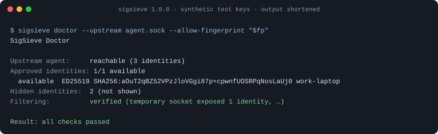

# SigSieve

**Forward only the SSH keys you choose.**

[](https://github.com/semihbugrasezer/sigsieve/actions/workflows/ci.yml)
[](https://github.com/semihbugrasezer/sigsieve/releases/latest)
[](LICENSE)

SigSieve is a small local proxy for SSH agent forwarding on macOS and Linux. When you forward your agent to a remote machine, the remote side sees **only the keys you allow**. Your keys stay in your existing agent, such as [Secretive](https://github.com/maxgoedjen/secretive) or OpenSSH `ssh-agent`, and are never exported.



> [!WARNING]
> **Not independently audited.** Automated tests do not establish production-grade security, and real-device Secretive testing covers [one configuration](docs/SECRETIVE_INTEGRATION.md#recorded-real-device-results). Read the [security model](docs/SECURITY_MODEL.md) and [limitations](docs/LIMITATIONS.md) before forwarding an agent, and keep an ordinary SSH access path.

## Why use it

- **Hide the keys a server does not need.** Forward one key instead of your whole agent.
- **Keep your agent.** Works in front of Secretive's Secure Enclave keys, which cannot be moved into another agent.
- **Optionally bind signing to a destination.** With `--allow-destination`, an allowed key signs only SSH logins to approved host keys.
- **Check before you connect.** `doctor` verifies the setup and `connect --dry-run` shows the exact SSH plan.

If your keys can be exported, OpenSSH's own [`ssh-add -h`](https://www.openssh.org/agent-restrict.html) may be enough. See [Do you need SigSieve?](docs/USAGE.md#do-you-need-sigsieve)

## Install

macOS (Apple Silicon):

```sh
brew install semihbugrasezer/sigsieve/sigsieve
```

Linux x86_64 (glibc 2.39+): use the [verified prebuilt archive](docs/INSTALL.md#verify-and-install-a-published-archive). Linux arm64 and older systems: [build from source](docs/INSTALL.md#install-the-tagged-version-from-source). Intel macOS and Windows are not validated. Requires OpenSSH 8.4+; no `sudo`, no changes to `~/.ssh`.

## Quick start

Nothing in steps 1 and 2 connects anywhere or signs with your key. Want to try it with a throwaway agent first? See the [five-minute quickstart](docs/QUICKSTART.md).

**1. Choose your agent and the key to allow.** List public fingerprints, then copy one.

OpenSSH agent:

```bash
src=(--upstream "${SSH_AUTH_SOCK:?start an SSH agent first}")
ssh-add -l
```

Secretive:

```bash
src=(--secretive)
SSH_AUTH_SOCK="$HOME/Library/Containers/com.maxgoedjen.Secretive.SecretAgent/Data/socket.ssh" ssh-add -l
```

```bash
fp='SHA256:REPLACE_WITH_YOUR_KEY_FINGERPRINT'
```

**2. Check the setup, then preview the connection** (`build-host` is your SSH host alias):

```bash
sigsieve doctor "${src[@]}" --allow-fingerprint "$fp"
sigsieve connect build-host "${src[@]}" --allow-fingerprint "$fp" --dry-run -- -o StrictHostKeyChecking=yes
```

A working setup ends with:

```text
Approved identities: 1/1 available
Hidden identities:  0 (not shown)
Filtering:          verified (temporary socket exposed 1 identity, non-allowlisted sign request rejected)

Result: all checks passed
```

`doctor` also prints a `denied sign request` line: that is its self-test with a synthetic key, not one of your keys.

**3. Connect.** After verifying the host's key through a trusted channel, run the same `connect` command without `--dry-run`. On the remote host, `ssh-add -l` lists only the key you allowed.

More: destination binding, a stable socket for `ssh_config`, every option and [troubleshooting](docs/USAGE.md#troubleshooting) are in [USAGE.md](docs/USAGE.md).

## Security at a glance

- A compromised remote host can still use an **allowed** key while forwarding is on. Forward only what that host needs, and disconnect when done.
- Destination binding checks the final destination's host key, not usernames or intermediate hops, and needs OpenSSH hostbound authentication.
- Replay of a recorded session is bounded, not prevented. With Secretive, a cancelled Touch ID prompt means reconnecting.
- Release files are immutable and come with SHA-256 checksums, SBOMs and build provenance. Test evidence is specific to the tested revision and is not a security certification.

Details: [security model](docs/SECURITY_MODEL.md) · [limitations](docs/LIMITATIONS.md) · [threat model](docs/THREAT_MODEL.md) · [v1.0.0 evidence](docs/TESTING.md#release-evidence-v100-2026-11-09) · [findings](docs/FINDINGS.md)

## Documentation

| | |
| --- | --- |
| Use | [Install](docs/INSTALL.md) · [Quickstart](docs/QUICKSTART.md) · [Usage and troubleshooting](docs/USAGE.md) · [Secretive](docs/SECRETIVE_INTEGRATION.md) · [SSH compatibility](docs/SSH_COMPATIBILITY.md) |
| Security | [Security model](docs/SECURITY_MODEL.md) · [Threat model](docs/THREAT_MODEL.md) · [Limitations](docs/LIMITATIONS.md) · [Findings](docs/FINDINGS.md) · [Testing](docs/TESTING.md) |
| Project | [Architecture](docs/ARCHITECTURE.md) · [Changelog](CHANGELOG.md) · [Contributing](CONTRIBUTING.md) · [Governance](GOVERNANCE.md) · [Support](SUPPORT.md) |

## Feedback and support

Tried it? Tell us what worked and what did not: [compatibility report](https://github.com/semihbugrasezer/sigsieve/issues/new?template=compatibility_report.yml) · [installation problem](https://github.com/semihbugrasezer/sigsieve/issues/new?template=installation_problem.yml) · [bug report](https://github.com/semihbugrasezer/sigsieve/issues/new?template=bug_report.yml). Remove real fingerprints, hostnames and IP addresses first.

**Security vulnerabilities:** never in a public issue. Use [private vulnerability reporting](https://github.com/semihbugrasezer/sigsieve/security/advisories/new) ([SECURITY.md](SECURITY.md)).

---

**License:** [MIT](LICENSE). See [third-party notices](docs/THIRD_PARTY.md).
