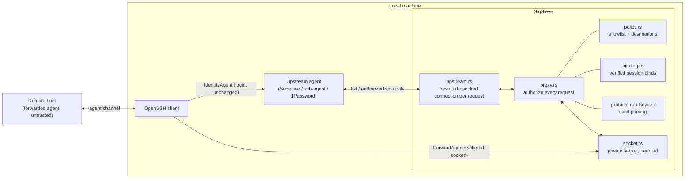

# SigSieve

**Your keys. Your rules.**

[](https://github.com/semihbugrasezer/sigsieve/actions/workflows/ci.yml)

**v0.1.0-alpha.2 — unreleased experimental candidate.** MIT-licensed; no telemetry, accounts or services.

SigSieve is a small SSH agent proxy written in Rust. It sits between your
real SSH agent (Secretive, OpenSSH `ssh-agent`, 1Password, …) and a
**forwarded agent on a remote machine**. It exposes only the identities you
allow, and can optionally restrict where an allowed identity may authenticate.

> [!WARNING]
> **Experimental security software. Not independently audited.** Read the
> [security model](docs/SECURITY_MODEL.md), [threat model](docs/THREAT_MODEL.md)
> and [limitations](docs/LIMITATIONS.md) before relying on it, and keep normal
> SSH access available as a fallback.

## The problem

`ssh -A` forwards your *whole* agent. Every host you forward to can list all
your keys and ask your agent to sign with any of them while you are
connected. Hardware-backed keys (Secure Enclave, FIDO) cannot be copied, but
a compromised server can still *use* them, including privileged keys that
were never meant for that machine.

```text
upstream agent (3 keys) ──► SigSieve ──► filtered socket (1 key) ──► ssh -o ForwardAgent=… ──► remote host
```

## When you don't need SigSieve

- **You only hop through a bastion.** `ProxyJump` (`ssh -J bastion target`)
  needs no agent forwarding at all; nothing is exposed to the bastion.
- **You use OpenSSH's own `ssh-agent`.** `ssh-add -h` (OpenSSH 8.9+) adds keys
  with destination constraints enforced by the agent itself.
- **You only need to pick a key per host.** `IdentityAgent`,
  `IdentityFile` and `IdentitiesOnly` in ssh_config do that.
- **Filtering by key comment is enough.** [ssh-agent-filter](https://git.tiwe.de/ssh-agent-filter.git/about/)
  (`afssh`) does that, without destination binding.

SigSieve is for the remaining case: you really need a forwarded agent on a
remote machine (e.g. `git` over SSH from a build host), and your agent cannot
constrain keys itself — for example Secretive / Secure Enclave. Other agents
may work through the same protocol, but consult the compatibility table below.

## What SigSieve enforces (tested)

| Property | Default (identity filtering) | With `--allow-destination` (destination binding) |
|---|---|---|
| Remote host sees only allowlisted keys | ✅ tested | ✅ tested |
| Non-allowlisted keys cannot sign, even with a known public key | ✅ tested | ✅ tested |
| Agent mutations, lock/unlock, PKCS#11, unknown messages refused | ✅ tested | ✅ tested |
| An allowed key can only authenticate to approved servers | ❌ any server that trusts it | ✅ only servers with the allowed host keys (cryptographically verified) |
| An allowed key can sign arbitrary data | ⚠️ yes | ❌ no: SSH user authentication only |
| Protection against a compromised local machine or upstream agent | ❌ out of scope | ❌ out of scope |

"Tested" means automated tests, many over real OpenSSH (`ssh` → throwaway
`sshd`) with raw-protocol attackers in the remote session. Details and test
names: [docs/SECURITY_MODEL.md](docs/SECURITY_MODEL.md).

**Filtering limits which keys a remote host can use. It never makes an
allowed key safe to hand to a compromised host.** Destination binding narrows
where the allowed key works. While you are connected, a compromised host can
still use it to authenticate to the allowed destinations.

## Features

- **Default deny**: nothing is exposed unless its SHA256 fingerprint is
  allowlisted. An invalid entry stops startup.
- **Authorization at signature time** from the requested key blob itself.
  Comments and listing history are never trusted.
- **Destination binding** (opt-in): verifies `session-bind@openssh.com`
  host-key signatures (Ed25519/ECDSA) and only signs user-authentication
  requests bound to an allowed destination. It uses OpenSSH's session-binding
  and hostbound-authentication protocols; SigSieve enforces the destination
  policy itself. Ordinary `publickey` requests are refused in this mode.
- **No mutation, no extension passthrough**: everything except listing and
  authorized signing is answered locally.
- **No private keys**: signing stays in the upstream agent, so Secretive's
  Secure Enclave and Touch ID policy still apply. Denied requests never reach
  it.
- **Hardened sockets**: private 0700 directory, peer-uid checks, never
  replaces or deletes files it did not create, bounded frames, connections
  and time.
- **`sigsieve connect`** starts ssh with only the filtered socket forwarded.
  It disables connection sharing and forwardings for the session, refuses
  unverifiable ProxyCommands, verifies the effective configuration with
  `ssh -G`, and cleans up. `--dry-run` shows the plan without connecting.
- No accounts, telemetry or config files; remote connections use your OpenSSH client.

The [protocol references](docs/REFERENCES.md) explain the RFC 9987 foundation,
OpenSSH extensions, and differences from OpenSSH destination constraints.

## Architecture



More: [docs/ARCHITECTURE.md](docs/ARCHITECTURE.md).

## Installation

Supported: macOS arm64 and Linux x86_64 (see [Compatibility](#compatibility)).
Requires a recent stable Rust toolchain (tested with 1.99.1, pinned by
`rust-toolchain.toml`) and OpenSSH 8.4 or newer.

```bash
# From a reviewed checkout, into ~/.cargo/bin
git clone https://github.com/semihbugrasezer/sigsieve
cd sigsieve
git rev-parse HEAD                   # verify CI for this exact revision
cargo install --locked --path .
sigsieve --version
```

No verified binary release is published yet. The alpha.1 source tag is
superseded; its release build was cancelled after another configuration flaw
was found. Wait for verified release artifacts for installation without Rust.

A Homebrew formula (building from source, so no Gatekeeper quarantine) is
prepared but not published yet. Verified release archives, when available, are listed on the
[Releases page](https://github.com/semihbugrasezer/sigsieve/releases).
Linux binary archives require glibc 2.39 or newer (Ubuntu 24.04 baseline);
build from source on older distributions.
SigSieve installs no services and changes no system or ssh configuration.

## Quick start (Secretive, about five minutes)

```bash
# 1. Find the fingerprint of the key the remote host may use
SSH_AUTH_SOCK=~/Library/Containers/com.maxgoedjen.Secretive.SecretAgent/Data/socket.ssh ssh-add -l

# 2. Check the setup: which keys would be exposed, which stay hidden
#    (hidden keys are not printed; nothing is signed with a real key)
sigsieve doctor --secretive --allow-fingerprint SHA256:AbC…

# 3. Preview, then open a session that forwards only that key
sigsieve connect build-host --secretive --allow-fingerprint SHA256:AbC… --dry-run
sigsieve connect build-host --secretive --allow-fingerprint SHA256:AbC…

# 4. On build-host: only the allowed key is visible
ssh-add -l
```

`connect` starts a filtered agent for the session, runs ssh with only that
agent forwarded (connection sharing and port forwardings off), verifies
ssh's effective configuration, including every ProxyJump hop, and cleans up
when ssh exits. Your login still uses your normal agent.

## Using it from ssh_config (stable socket)

For plain `ssh` without `sigsieve connect`, run the filtered agent on a
fixed path and point `ForwardAgent` at it:

```bash
mkdir -m 700 ~/.sigsieve                  # must be private: SigSieve checks
sigsieve run --secretive --allow-fingerprint SHA256:AbC… \
  --socket ~/.sigsieve/agent.sock         # keep it running (e.g. a terminal tab)
```

```sshconfig
Host build-host
  # OpenSSH 8.4+: forward this socket only
  ForwardAgent ~/.sigsieve/agent.sock
  # a shared master connection would forward its own, unfiltered agent
  ControlPath none
```

Put any `-o ForwardAgent=…` on the ssh command line first: ssh uses the first
value it sees. `connect` does all of this for you and verifies it.
An annotated configuration is in [examples/ssh_config](examples/ssh_config).

Check it with `sigsieve status --socket ~/.sigsieve/agent.sock`. If the
process was killed, the next `sigsieve run` on that path takes the socket
over when it can prove it was left by the dead instance (see
[Uninstall and recovery](#uninstall-and-recovery)). There is no launchd or
systemd unit; keep it in the foreground or in a terminal multiplexer.

**Through a bastion:** `ProxyJump` works with `connect`; the bastion needs no
agent and each hop is verified:

```sshconfig
Host build-host
  ProxyJump bastion
```

**Destination binding** (the forwarded key may only log in to servers you
name, onward from the build host). This requires a destination supporting
OpenSSH hostbound authentication; an arbitrary Git/SSH service may not support it:

```bash
ssh-keyscan -t ed25519 destination.example | ssh-keygen -lf -
# Verify this fingerprint through the destination operator's trusted channel.
sigsieve connect build-host --secretive --allow-fingerprint SHA256:AbC… \
  --allow-destination "SHA256:REPLACE_WITH_VERIFIED_HOST_KEY_FINGERPRINT"
```

## Other agents (ssh-agent, 1Password, …)

```bash
# 1. Pick the key to expose
SSH_AUTH_SOCK=/path/to/agent.sock ssh-add -l

# 2. Check everything (no hidden keys are printed, nothing is signed)
sigsieve doctor --upstream /path/to/agent.sock --allow-fingerprint SHA256:AbC…

# 3. Preview the connection plan, then connect
sigsieve connect ci-vps --upstream /path/to/agent.sock --allow-fingerprint SHA256:AbC… --dry-run
sigsieve connect ci-vps --upstream /path/to/agent.sock --allow-fingerprint SHA256:AbC… \
  -- -o StrictHostKeyChecking=yes

# Optional: also restrict where the key may authenticate from the remote host
# (host key fingerprint of the server the remote host should reach)
sigsieve connect ci-vps --upstream /path/to/agent.sock --allow-fingerprint SHA256:AbC… \
  --allow-destination "SHA256:REPLACE_WITH_VERIFIED_HOST_KEY_FINGERPRINT"
```

## Secretive (macOS)

`--secretive` uses Secretive's socket
(`~/Library/Containers/com.maxgoedjen.Secretive.SecretAgent/Data/socket.ssh`):

```bash
sigsieve doctor  --secretive --allow-fingerprint SHA256:AbC…
sigsieve connect ci-vps --secretive --allow-fingerprint SHA256:AbC…
scripts/agent-integration-check.sh --sigsieve target/release/sigsieve --allow SHA256:AbC…
```

Whether a signature prompts for Touch ID depends on Secretive's per-key
setting and macOS caching. SigSieve neither adds nor removes prompts. Denied
requests never reach Secretive. See
[docs/SECRETIVE_INTEGRATION.md](docs/SECRETIVE_INTEGRATION.md).

## CLI

```text
sigsieve run      [--upstream PATH | --secretive] [--allow-fingerprint FP]... [--allow-destination HK]... [--socket PATH]
sigsieve doctor   [--upstream PATH | --secretive] [--allow-fingerprint FP]... [--allow-destination HK]... [--socket PATH]
sigsieve status   [--socket PATH]          (default: $SSH_AUTH_SOCK)
sigsieve connect  HOST [--upstream PATH | --secretive] --allow-fingerprint FP... [--allow-destination HK]...
                  [--dry-run] [--ssh PATH] [-- SSH_ARGS...]
```

- Lists are repeatable or comma-separated. `SIGSIEVE_UPSTREAM`,
  `SIGSIEVE_ALLOW` and `SIGSIEVE_DESTINATIONS` supply defaults.
  `SSH_AUTH_SOCK` is never an implicit upstream.
- `--upstream-timeout SECS` (default 120) covers Touch ID waits.
- Agent I/O and queue wait share that deadline; cancellation stops initial
  queries and in-flight proxy I/O. Per-session budgets bound connections,
  requests, signing attempts and logs; see [resource limits](docs/RESOURCE_LIMITS.md).
- Exit codes: `0` success, `1` runtime failure or failed check, `2` invalid
  usage/configuration. `connect` returns ssh's exit code once ssh has started.
- `connect` rules for ssh_config (ProxyCommand, ControlMaster, forwards,
  IdentityAgent, …): [docs/SSH_COMPATIBILITY.md](docs/SSH_COMPATIBILITY.md).

## Compatibility

| | Status |
|---|---|
| macOS arm64 | tested locally (OpenSSH 10.3) |
| Linux x86_64 | release target; Ubuntu 24.04 CI requires debug/release tests, real sshd, peer-uid rejection and umask 0002 |
| Linux aarch64 | included in CI; source builds only, no binary archive |
| OpenSSH `ssh-agent`, `ssh`, `sshd` | tested end to end |
| Secretive (ECDSA P-256) | user-assisted real test passed (listing, hidden-key refusal, `connect`); signing and destination binding with Secretive not yet run |
| 1Password SSH agent | standard protocol; untested |
| Identity key types | Ed25519, ECDSA P-256/384/521, RSA (≥1024, rsa-sha2-*), `sk-` (untested with hardware); certificates unsupported |

## Troubleshooting

| Message | Meaning and fix |
|---|---|
| `upstream agent unreachable` | The upstream agent is not running (start Secretive) or the path is wrong. |
| `none of the allowlisted identities is present` | The fingerprint is not in the upstream agent; list keys with step 1 of the quick start. |
| `refusing to connect: ProxyCommand … cannot be verified` | `connect` allows only plain `ssh -W` relays and `ProxyJump`. Use `ProxyJump`, or `sigsieve run` + plain ssh after checking the tool never forwards an agent. |
| `unsupported control character` | Use LF line endings in your SSH configuration; move inline Include comments to separate lines. A dedicated `-F` file can avoid unsupported syntax. |
| `… on proxy hop …` | A jump host's own ssh_config runs a program (ProxyCommand wrapper, LocalCommand, KnownHostsCommand). Fix that host's entry. |
| `` `Match exec` would run a command `` | Any `Match … exec` in your ssh config (or an included file) is refused before ssh runs. Use `Match host`/`user`, or pass a dedicated `-F` file. |
| `refusing to replace existing path …` | Another process uses the socket, or SigSieve cannot prove it is a stale one of its own. The message says which; see below. |
| The jump host rejects your key | Hops do not receive `connect`'s `-o` options: put their `User`, `IdentityFile`, `IdentityAgent` in ssh_config. |
| More Touch ID prompts than expected | SigSieve adds none; denied requests never reach Secretive. Check Secretive's per-key setting. |
| `signing budget exhausted or duplicate …` | The session is busy or that destination-bound authentication was already attempted. Start a new SSH authentication session; repeated requests do not automatically retry the agent. |

`sigsieve doctor` checks a setup without connecting; `connect --dry-run`
prints the verified plan.

## Uninstall and recovery

SigSieve installs nothing system-wide: no daemons or launch agents, no
configuration files, and no changes to `~/.ssh/config`, your agent or
Secretive. Your normal SSH access never depends on it.

1. Stop running instances with Ctrl-C or `kill -TERM <pid>`. They remove
   their socket and state file on exit. `connect` sessions clean up when ssh
   exits.
2. After a crash or `kill -9`, the socket and state file are left behind.
   The next `sigsieve run --socket` on the same path takes them over only
   if it can prove they belong to the dead instance (the state file records
   that exact socket, its pid is gone and nothing listens), and says so.
   Otherwise it refuses and explains why. To clean up by hand, confirm
   nothing uses the socket, then remove it:

   ```bash
   sigsieve status --socket /path/to/agent.sock   # must report NOT RUNNING
   rm /path/to/agent.sock /path/to/agent.sock.state
   rmdir "$(dirname /path/to/agent.sock)"          # only for sigsieve-XXXX temp dirs
   ```

3. Remove the binary: `cargo uninstall sigsieve` (if installed with
   `cargo install`), or delete the file you copied.
4. If you forwarded manually, stop passing `-o ForwardAgent=<socket>`. Plain
   `ssh host` works exactly as before.

## Development

See [docs/TESTING.md](docs/TESTING.md) and [CONTRIBUTING.md](CONTRIBUTING.md).

```bash
cargo fmt --all -- --check
cargo clippy --all-targets --all-features -- -D warnings
SIGSIEVE_REQUIRE_SSHD=1 cargo test --all-targets
cargo test --release
```

## Security

Report vulnerabilities privately: [SECURITY.md](SECURITY.md). Known findings
and their status: [docs/FINDINGS.md](docs/FINDINGS.md). Release gates:
[docs/RELEASE_CHECKLIST.md](docs/RELEASE_CHECKLIST.md).

Current engineering review: [SECURITY_AUDIT.md](SECURITY_AUDIT.md),
[product scope](PRODUCT_STRATEGY.md), [delivery ledger](IMPLEMENTATION_PLAN.md)
and [executed compatibility report](docs/COMPATIBILITY_REPORT.md).

## License

[MIT](LICENSE)
