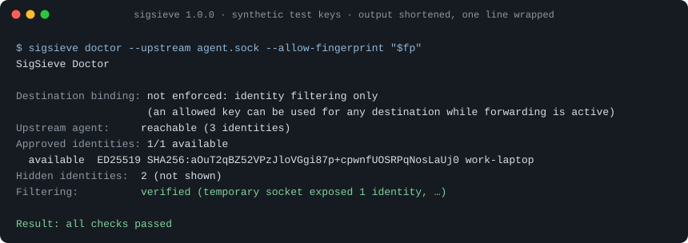

<p align="center">
  
</p>

<h1 align="center">SigSieve</h1>

<p align="center"><strong>Forward only the SSH keys you choose.</strong></p>

<p align="center">
  <a href="https://github.com/semihbugrasezer/sigsieve/actions/workflows/ci.yml"></a>
  <a href="https://github.com/semihbugrasezer/sigsieve/releases/latest"></a>
  <a href="LICENSE"></a>
</p>

<p align="center">
  <a href="#install">Install</a> ·
  <a href="#quick-start">Quick start</a> ·
  <a href="#macos-app-preview">macOS app</a> ·
  <a href="#security-at-a-glance">Security</a> ·
  <a href="#documentation">Documentation</a>
</p>

SigSieve is a small local proxy for SSH agent forwarding on macOS and Linux. The agent you forward through it lists only the keys you allow and serves sign requests only for them; requests to add, remove or lock keys are refused. Your keys stay in your existing agent, such as [Secretive](https://github.com/maxgoedjen/secretive) or OpenSSH `ssh-agent`, and are never exported. **An allowed key stays fully usable from the remote host (by its root and by your remote user) for as long as forwarding lasts:** by default it can sign anything and log in to any server that trusts it; with `--allow-destination` it signs only SSH logins (as any user, via OpenSSH hostbound authentication) to the final destination host keys you approve.



> [!WARNING]
> **Not independently audited.** Automated tests do not establish production-grade security, and real-device Secretive testing covers [one configuration](docs/SECRETIVE_INTEGRATION.md#recorded-real-device-results). Read the [security model](docs/SECURITY_MODEL.md) and [limitations](docs/LIMITATIONS.md) before forwarding an agent, and keep an ordinary SSH access path.

## Why use it

- **Hide the keys a server does not need.** Forward one key instead of your whole agent.
- **Keep your agent.** Works in front of Secretive's Secure Enclave keys, which cannot be moved into another agent.
- **Optionally bind signing to a destination.** With `--allow-destination`, an allowed key signs only SSH logins (as any user) to the destination host keys you approve; the destination server must support OpenSSH hostbound authentication.

If your keys can be exported, OpenSSH's own [`ssh-add -h`](https://www.openssh.org/agent-restrict.html) may be enough. See [Do you need SigSieve?](docs/USAGE.md#do-you-need-sigsieve)

## Install

macOS (Apple Silicon):

```sh
brew install semihbugrasezer/sigsieve/sigsieve
```

This installs the `sigsieve` CLI only; Homebrew builds it from source. The macOS app is a source-only [preview](#macos-app-preview).

Linux x86_64 (glibc 2.39+): use the [verified prebuilt archive](docs/INSTALL.md#verify-and-install-a-published-archive). Linux arm64 and older systems: [build from source](docs/INSTALL.md#install-the-tagged-version-from-source). Intel macOS and Windows are not validated. Requires OpenSSH 8.4+ (8.7+ for ProxyJump); no `sudo`, no changes to `~/.ssh`. See the full [support matrix](docs/INSTALL.md#supported-platforms); upgrade and uninstall steps are in [INSTALL.md](docs/INSTALL.md).

## Quick start

Nothing in steps 1 and 2 connects anywhere or signs with your key. Want to try it with a throwaway agent first? See the [five-minute quickstart](docs/QUICKSTART.md).

**1. Choose your agent and the key to allow.** List public fingerprints, then copy one.

OpenSSH agent:

```bash
src=(--upstream "${SSH_AUTH_SOCK:?start an SSH agent first}")
ssh-add -l
```

Secretive:

```bash
src=(--secretive)
SSH_AUTH_SOCK="$HOME/Library/Containers/com.maxgoedjen.Secretive.SecretAgent/Data/socket.ssh" ssh-add -l
```

```bash
fp='SHA256:REPLACE_WITH_YOUR_KEY_FINGERPRINT'
```

**2. Check the setup, then preview the connection** (`build-host` is your SSH host alias):

```bash
sigsieve doctor "${src[@]}" --allow-fingerprint "$fp"
sigsieve connect build-host "${src[@]}" --allow-fingerprint "$fp" --dry-run -- -o StrictHostKeyChecking=yes
```

A working setup includes (other lines omitted):

```text
Approved identities: 1/1 available
Hidden identities:  0 (not shown)
Filtering:          verified (temporary socket exposed 1 identity, non-allowlisted sign request rejected)

Result: all checks passed
```

`doctor` also prints a `denied sign request` line: that is its self-test with a synthetic key, not one of your keys.

**3. Connect.** After verifying the host's key through a trusted channel, run the same `connect` command without `--dry-run`. On the remote host, `ssh-add -l` lists only the key you allowed.

More: destination binding, a stable socket for `ssh_config`, every option and [troubleshooting](docs/USAGE.md#troubleshooting) are in [USAGE.md](docs/USAGE.md).

## macOS app (preview)

A menu bar app for the same CLI.

- **See it at a glance:** which server, which keys it may use, and how the connection is protected.
- **Connect only after a passed check:** the protection mode and its warning are shown before any check, and Connect stays off until the CLI's check passes.
- **Same enforcement:** the `sigsieve` CLI still does all filtering and checking, and re-checks when it connects. The app adds no security of its own.

<table>
  <tr>
    <td width="55%"></td>
    <td width="45%"></td>
  </tr>
  <tr>
    <td align="center"><sub>Main window after a passed check</sub></td>
    <td align="center"><sub>Settings</sub></td>
  </tr>
</table>

The app is built from source, ad hoc signed, and not notarized or distributed yet. Build steps and manual checks: [macos-app/README.md](macos-app/README.md). The screenshots use a test server name and a throwaway agent with synthetic keys.

## Security at a glance

- A compromised remote host can still use an **allowed** key while forwarding is on. Forward only what that host needs, and disconnect when done.
- Destination binding restricts only the final destination's host key, not usernames or intermediate hops; see [limitations](docs/LIMITATIONS.md#security).
- Replay of a recorded session is bounded, not prevented. With Secretive, a cancelled Touch ID prompt means reconnecting.
- The prebuilt release archives are immutable and come with SHA-256 checksums, SBOMs and build provenance. The Homebrew formula builds from source and is checked only by the source archive's SHA-256. Test evidence is specific to the tested revision and is not a security certification.

Details: [security model](docs/SECURITY_MODEL.md) · [limitations](docs/LIMITATIONS.md) · [threat model](docs/THREAT_MODEL.md) · [v1.0.0 evidence](docs/TESTING.md#release-evidence-v100-2026-11-09) · [findings](docs/FINDINGS.md)

## Documentation

| | |
| --- | --- |
| Use | [Install](docs/INSTALL.md) · [Quickstart](docs/QUICKSTART.md) · [Usage and troubleshooting](docs/USAGE.md) · [Secretive](docs/SECRETIVE_INTEGRATION.md) · [SSH compatibility](docs/SSH_COMPATIBILITY.md) · [macOS app (preview)](macos-app/README.md) |
| Security | [Security model](docs/SECURITY_MODEL.md) · [Threat model](docs/THREAT_MODEL.md) · [Limitations](docs/LIMITATIONS.md) · [Findings](docs/FINDINGS.md) · [Testing](docs/TESTING.md) |
| Project | [Architecture](docs/ARCHITECTURE.md) · [Changelog](CHANGELOG.md) · [Contributing](CONTRIBUTING.md) · [Governance](GOVERNANCE.md) · [Support](SUPPORT.md) |

## Feedback and support

Tried it? Tell us what worked and what did not: [compatibility report](https://github.com/semihbugrasezer/sigsieve/issues/new?template=compatibility_report.yml) · [installation problem](https://github.com/semihbugrasezer/sigsieve/issues/new?template=installation_problem.yml) · [bug report](https://github.com/semihbugrasezer/sigsieve/issues/new?template=bug_report.yml). Remove real fingerprints, hostnames and IP addresses first.

**Security vulnerabilities:** never in a public issue. Use [private vulnerability reporting](https://github.com/semihbugrasezer/sigsieve/security/advisories/new) ([SECURITY.md](SECURITY.md)).

---

**License:** [MIT](LICENSE). See [third-party notices](docs/THIRD_PARTY.md).
