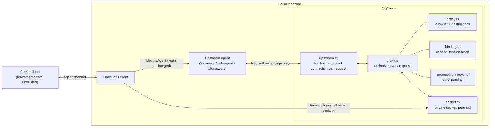

# Architecture

A single synchronous Rust binary on top of a small library crate. No async
runtime: one thread per downstream connection, capped by a registry, which
keeps control flow and state easy to audit.

## Components



## Modules

| Module | Responsibility | Trust boundary |
|---|---|---|
| `protocol.rs` | frame I/O with deadlines; bounds-checked `Reader`; message constants | parses untrusted bytes |
| `keys.rs` | structural validation of public-key blobs; SHA256 fingerprints | parses untrusted bytes |
| `policy.rs` | immutable allowlist + optional destination set | the authorization inputs |
| `binding.rs` | verified `session-bind` state per connection; destination authorization of sign requests; host-key signature verification (Ed25519/ECDSA via RustCrypto) | parses + verifies untrusted bytes |
| `proxy.rs` | `handle_request` (the only dispatcher), per-connection loop with binding state, accept loop with poll(2), connection registry with idle eviction | enforces policy |
| `proxy/resources.rs` (private) | shared token budgets, FIFO upstream concurrency permits, bounded digest cache and log accounting | bounds abuse; never authorizes a key or caches a signature |
| `upstream.rs` | fresh, uid-checked connection to the real agent per request; strict reply parsing | talks to the trusted agent |
| `socket.rs` | private dir creation, bind, permission checks, peer uid, inode-checked cleanup, `poll`, signals to child; **all `unsafe`** (documented OS calls) | OS |
| `ssh.rs` | effective SSH options and recursive proxy-hop verification | trusted local SSH client, user configuration |
| `sshconfig.rs` | conservative pre-scan of user SSH configuration and includes; refuses command execution before probing SSH | user configuration |
| `cli.rs` | `run`, `doctor`, `status`, `connect` (incl. `--dry-run`) | user input, child processes |
| `fuzzing.rs` | invariant-asserting fuzz entry points (not a stable API) | tests only |

## Request flow

```mermaid
sequenceDiagram
    participant C as Client (remote, via ssh)
    participant P as SigSieve
    participant U as Upstream agent
    C->>P: frame (≤ 256 KiB, deadline-bounded)
    alt REQUEST_IDENTITIES
        P->>U: REQUEST_IDENTITIES (new connection)
        U-->>P: IDENTITIES_ANSWER
        P-->>C: rebuilt answer: allowlisted, well-formed, deduplicated
    else EXTENSION session-bind (destination binding on)
        P->>P: verify host-key signature over session id; apply OpenSSH binding rules
        P-->>C: SUCCESS / FAILURE (never forwarded)
    else SIGN_REQUEST
        P->>P: strict parse; key allowlisted? flags valid for this key type?
        P->>P: [binding on] userauth for latest auth binding to allowed host key?
        alt authorized
            P->>P: signing budget + duplicate check; FIFO concurrency permit
            P->>U: identical bytes (new connection, no retry)
            U-->>P: SIGN_RESPONSE / FAILURE
            P-->>C: validated response or FAILURE
        else denied
            P-->>C: FAILURE (upstream never contacted)
        end
    else anything else
        P-->>C: FAILURE (never forwarded)
    end
```

## `connect` lifecycle

1. Validate destination (no leading `-`) and allowlist (non-empty).
2. Install SIGTERM/SIGHUP (stop ssh, clean up) and SIGINT handlers.
3. Query upstream; at least one allowlisted key must be present.
4. Create a private runtime dir + socket; start the proxy thread.
5. Self-test through the filtered socket: only allowlisted keys listed; a
   synthetic non-allowlisted sign request refused.
6. Probe `ssh -G` (without forward clearing) to learn the configured
   `IdentityAgent` and warn about forwards that will be disabled.
7. Build the final invocation (§ SSH_COMPATIBILITY.md) and run it with `-G`
   using the same arguments and environment; verify forwarding, sharing,
   forwards, ProxyCommand, LocalCommand and path references.
8. `--dry-run`: print the plan and stop. Otherwise abort if a signal arrived,
   then spawn ssh (argument vector, no shell).
9. On exit (or SIGTERM/SIGHUP → SIGTERM, then SIGKILL after 3 s): stop the
   proxy, remove socket and directory, return ssh's status.

## Dependencies

| Crate | Why |
|---|---|
| `sha2`, `base64` | fingerprints |
| `ed25519-dalek` 3, `p256`/`p384`/`p521` 0.14 (RustCrypto; `crypto-bigint` ≥ 0.7.9) | verifying host-key signatures for session binding; verification only |
| `libc` | peer credentials, `getuid`, `poll`, `kill` |
| `signal-hook` | signal flags for cleanup |
| `clap` | CLI |

`ssh-agent-lib` was evaluated and not used (tokio/futures/async-trait, and
decode-then-re-encode via `ssh-key` widens the parsing surface; SigSieve
forwards the byte-exact authorized request). `ssh-key` was not used for
verification to avoid pulling the `rsa` crate (RSA host keys are deliberately
unsupported for binding).

Runtime dependencies are listed in [Cargo.toml](../Cargo.toml). CI checks
both dependency advisories and the license/source policy in `deny.toml`.

## Resource ownership

`Proxy::new` fixes the policy, upstream and limits together; callers cannot
mutate them after creating the associated budgets. Runtime and request fuzzing
use the same guarded `Proxy::handle_request` entry point. Only validated,
authorized operations enter the upstream queue. Its wait and the whole exchange
share one deadline; permits release on every return/panic through RAII.

The socket helper creates nonblocking, close-on-exec upstream descriptors
(atomic flags on Linux, immediate CLOEXEC setup on macOS as in std). Apple
SO_NOSIGPIPE is explicitly preserved. Nonblocking connect never retries a Linux
full-backlog EAGAIN; genuine in-progress connections use poll and SO_ERROR.
See [RESOURCE_REFERENCES.md](RESOURCE_REFERENCES.md) for the OS evidence and
remaining filesystem/scheduler limits. No async runtime, background daemon,
global cwd changes or new runtime dependency was introduced.
